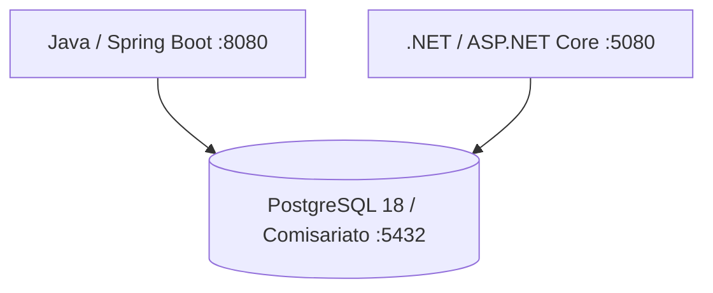

# Taller de Integración — Comisariato

**PUCE Manabí · Campus Portoviejo · Carrera de Software**  
Asignatura: Práctica en Gestión de la Información  
Integrantes: John Steven López Vélez (Java) y Ariel Gonzalo Moreira Macías (.NET)  
Fecha de las pruebas: 24 de noviembre de 2026

## Objetivo

Implementar dos aplicaciones REST autónomas que consultan y modifican la misma base de datos `Comisariato`. Las aplicaciones no comparten código ni se llaman entre sí: los procedimientos almacenados, la función, la vista y las transacciones de PostgreSQL constituyen el punto común.



La guía original utiliza SQL Server. Este trabajo adapta el acceso a datos a PostgreSQL 18 mediante JDBC y Npgsql, y el deadlock 1205 a SQLSTATE `40P01`. La aceptación académica de esa adaptación debe confirmarse con la docente.

## Tecnologías y estructura

| Java | .NET |
|---|---|
| Java 21, Spring Boot 3, Maven | .NET 8, ASP.NET Core |
| Spring JDBC, HikariCP, driver PostgreSQL | ADO.NET, Npgsql, Polly |
| springdoc-openapi, Actuator | Swashbuckle, HealthChecks |
| JUnit, Mockito, MockMvc, Postman | xUnit, Bruno |

```text
java-api/        API Java y menú web
dotnet-api/      API .NET y menú web
dotnet-api-tests/  Pruebas xUnit
database/        Script SQL de demostración
docs/            Colección Postman y documentación
bruno/           Colección de pruebas .NET
```

Ambas implementaciones están fusionadas en `main`. La versión utilizada en la demostración conjunta es `8efbb8a` (PR #4).

## Requisitos y base de datos

- Git, PostgreSQL 18, Java 21, Maven y .NET SDK 8.
- Usuario PostgreSQL con permisos para utilizar los objetos de la base. pgAdmin 4 es opcional para verificar los datos.

Clonar si todavía no se dispone del repositorio:

```sh
git clone https://github.com/JohnSteven329/Taller-Integracion-Comisariato.git
cd Taller-Integracion-Comisariato
```

Si ya existe la base `Comisariato` del taller con los objetos compatibles, utilizarla sin restaurar nuevamente. Para una instalación limpia, crear una base vacía y ejecutar el script de demostración desde la raíz (requiere las herramientas de PostgreSQL en PATH y permisos adecuados):

```sh
createdb -U postgres Comisariato
psql -X -v ON_ERROR_STOP=1 -U postgres -d Comisariato -f database/Comisariato_demo.sql
```

**No ejecutar el script sobre una base que contenga datos que deban conservarse.** Las dos APIs deben apuntar al mismo servidor, puerto y nombre de base.

## Ejecutar las dos aplicaciones

Abrir dos terminales independientes desde la raíz del repositorio. No guardar contraseñas reales en archivos versionados, capturas o commits.

### Java (PowerShell)

```powershell
cd java-api
if (-not (Test-Path .\src\main\resources\application.yml)) {
    Copy-Item .\src\main\resources\application.yml.example .\src\main\resources\application.yml
}
$env:DB_URL = 'jdbc:postgresql://localhost:5432/Comisariato'
$env:DB_USER = 'postgres'
$env:DB_PASSWORD = [System.Net.NetworkCredential]::new('', (Read-Host 'Contraseña PostgreSQL' -AsSecureString)).Password
mvn spring-boot:run
```

Para Linux/macOS, consultar el [README de Java](java-api/README.md), que incluye la configuración en Bash. La aplicación utiliza Spring JDBC sin JPA/Hibernate, con arquitectura controller → service → repository y configuración HikariCP.

### .NET (PowerShell, segunda terminal)

```powershell
cd dotnet-api
$clave = [System.Net.NetworkCredential]::new('', (Read-Host 'Contraseña PostgreSQL' -AsSecureString)).Password
$env:ConnectionStrings__DefaultConnection = "Host=localhost;Port=5432;Database=Comisariato;Username=postgres;Password=$clave"
Remove-Variable clave
$env:ASPNETCORE_URLS = 'http://localhost:5080'
dotnet restore
dotnet run --no-launch-profile
```

Si la contraseña contiene caracteres especiales de una cadena de conexión, usar el formato de escape de Npgsql. En Linux/macOS (Bash):

```bash
cd dotnet-api
read -rsp 'Contraseña PostgreSQL: ' DB_PASSWORD; echo
export ConnectionStrings__DefaultConnection="Host=localhost;Port=5432;Database=Comisariato;Username=postgres;Password=$DB_PASSWORD"
unset DB_PASSWORD
export ASPNETCORE_URLS='http://localhost:5080'
dotnet restore
dotnet run --no-launch-profile
```

`appsettings.json` y `appsettings.example.json` contienen valores de ejemplo; `appsettings.Development.json` configura logging. La API emplea ADO.NET con Npgsql, sin Entity Framework, y operaciones asíncronas.

### Acceso local

| Recurso | Java | .NET |
|---|---|---|
| Menú web | [8080/menu.html](http://localhost:8080/menu.html) | [5080/menu.html](http://localhost:5080/menu.html) |
| Swagger | [Swagger UI](http://localhost:8080/swagger-ui.html) | [Swagger UI](http://localhost:5080/swagger) |
| Health check | [/actuator/health](http://localhost:8080/actuator/health) | [/health](http://localhost:5080/health) |
| OpenAPI JSON | [/v3/api-docs](http://localhost:8080/v3/api-docs) | [/swagger/v1/swagger.json](http://localhost:5080/swagger/v1/swagger.json) |

Los health checks deben indicar `UP` (Java) y `Healthy` (.NET).

## Operaciones REST

| Método | Ruta | Resultado esperado |
|---|---|---|
| POST | `/api/ventas` | 201; 400, 409, 422 ante errores de validación, duplicado y stock |
| POST | `/api/ventas/{ventaId}/anular` | 200; 404 si no existe, 409 si ya está anulada |
| GET | `/api/productos/stock-bajo` | 200, lista de productos |
| GET | `/api/empleados/{empleadoId}/ventas` | 200, `[]` si existe sin ventas; 404 si no existe |
| GET | `/api/productos/{productoId}/movimientos` | 200, historial de inventario |

También se manejan errores inesperados HTTP 500. Los códigos adicionales según validaciones y módulo se describen en Swagger y en el código. Las APIs presentan respuestas de error estructuradas (`ProblemDetail` / `ProblemDetails`).

### Registrar venta

Enviar a `/api/ventas` del módulo elegido con `Content-Type: application/json` y una factura única. Los IDs deben existir y el producto debe tener stock suficiente.

```json
{
  "numeroFactura": "DEMO-FACTURA-001",
  "clienteId": 1,
  "empleadoId": 1,
  "formaPago": "Efectivo",
  "productoId": 1,
  "cantidad": 2
}
```

El contrato compartido admite un producto por venta. El procedimiento calcula subtotal, IVA y total; el cliente no envía esos importes. Para el precio de demostración de 1,10, dos unidades generan subtotal 2,20, IVA 0,33 y total 2,53. .NET permite cliente opcional y las formas de pago Efectivo, Tarjeta o Transferencia.

### Anular venta

Utilizar el identificador devuelto por el registro. En Java, enviar `{"empleadoId":1}` como JSON, ajustando el ID a un empleado válido. En .NET no se requiere cuerpo: la aplicación obtiene el empleado de la venta. Ambas llaman al procedimiento compartido de anulación y recuperan las unidades vendidas.

## Objetos de base de datos y transacciones

| Objeto | Responsabilidad |
|---|---|
| `public.usp_registrarventa` | Registrar venta y detalle, calcular importes y descontar inventario; incluye `INOUT p_ventaid` |
| `public.usp_anularventa` | Anular venta (`p_ventaid`, `p_empleadoid`) y reponer stock |
| `public.vw_productosstockbajo` | Consultar productos en el umbral de stock bajo |
| `public.fn_ventasporempleado` | Consultar ventas de un empleado |
| `public.movimientosinventario` | Consultar trazabilidad de entradas y salidas |

Las escrituras se ejecutan en transacciones de servicio, con commit si son exitosas y rollback ante excepciones. Se utilizan registros INFO/Information para operaciones exitosas y ERROR/Error para fallos. Java aplica un reintento manual ante `40P01`; .NET usa Polly, con un reintento de un segundo ante los errores de concurrencia configurados (`40P01` y `40001`). Cada reintento se realiza fuera de la transacción fallida.

## Pruebas y resultados

Desde la raíz, ejecutar en terminales separadas:

```sh
cd java-api
mvn clean test
```

```sh
dotnet test dotnet-api-tests/Comisariato.Api.Tests.csproj
```

- Java: importar [colección Postman](docs/Comisariato_Java.postman_collection.json).
- .NET: importar [colección Bruno](bruno/Comisariato-API-DotNet/opencollection.yml), o ejecutar `bru run bruno/Comisariato-API-DotNet --env Demo` desde la raíz si Bruno CLI está instalado.
- Las colecciones de escritura deben ejecutarse con datos de demostración y facturas únicas; la colección Bruno original supone una base limpia. No restaurar una base de trabajo para repetir una prueba.

| Comprobación | Resultado registrado |
|---|---|
| Java — Maven/JUnit | 8/8 |
| Java — Postman (prueba individual previa) | 10/10 |
| .NET — xUnit | 5/5 |
| .NET — Bruno (prueba individual previa) | 17 solicitudes, 24/24 comprobaciones |
| Integración Java → .NET | Venta 12 registrada en Java y anulada en .NET |
| Integración .NET → Java | Venta 13 registrada en .NET y anulada en Java |
| Concurrencia | Ventas 16 y 17, ambas HTTP 201; anuladas posteriormente |
| Inventario del producto 1 | 93 unidades iniciales y 93 finales |

Las cuatro ventas conjuntas quedaron anuladas, con cuatro salidas y cuatro entradas por 78 unidades en cada sentido. Se verificaron los errores HTTP, incluyendo 500 mediante pruebas automatizadas. Los deadlocks reales corresponden a evidencias históricas individuales, no a una nueva reproducción en el video final.

Consultar [resultados de integración](docs/Resultados_Integracion.md) para los IDs, movimientos, alcance y limitaciones de la demostración. El informe técnico y el MP4 sin audio se entregan por separado; no se incluyen en el código fuente. Las credenciales locales y las capturas de trabajo deben permanecer fuera de Git.
